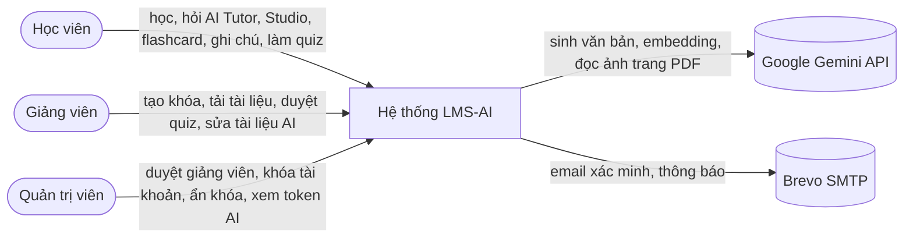
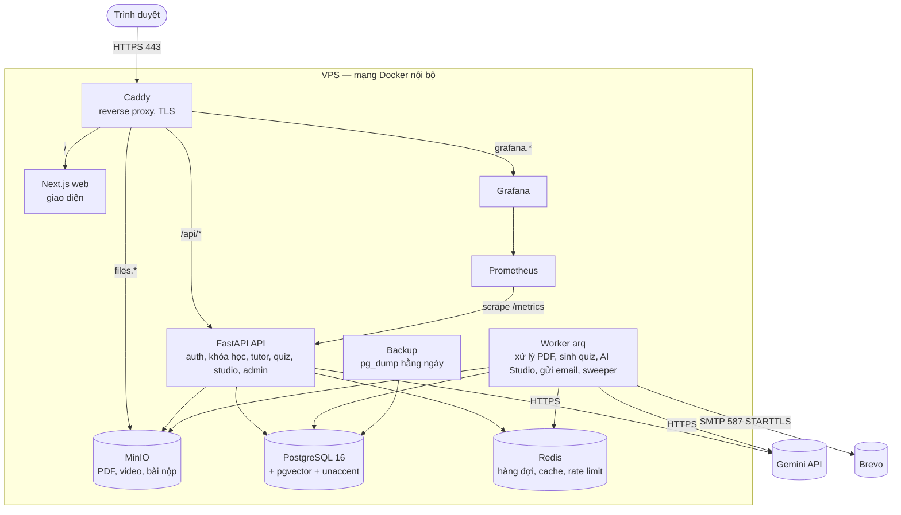
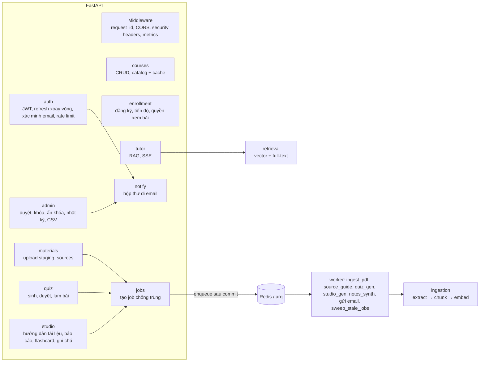
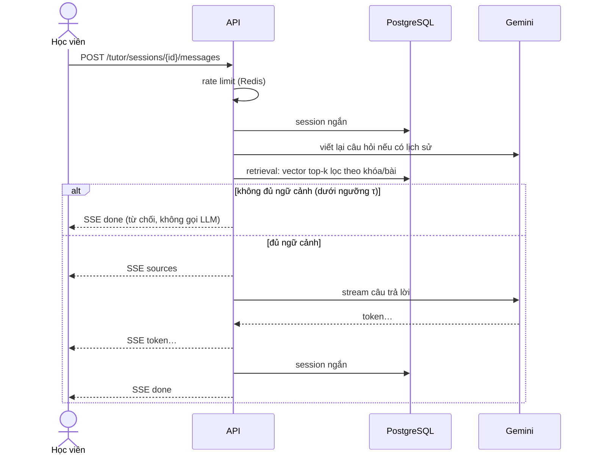
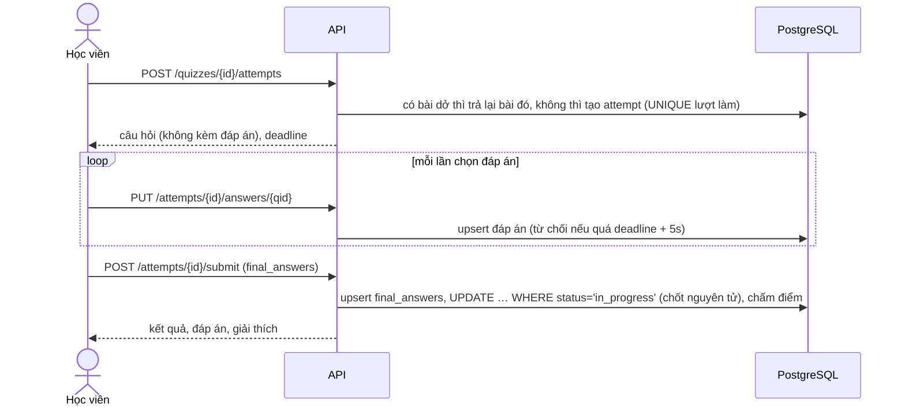
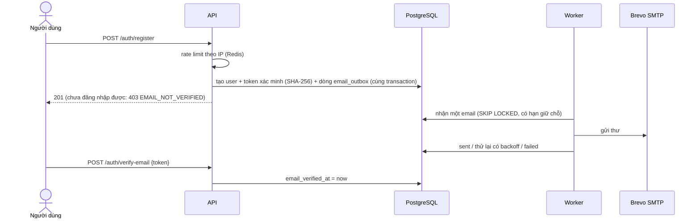

# Kiến trúc LMS-AI

## 1. Ngữ cảnh (C4 mức 1)



## 2. Container (C4 mức 2) và triển khai



## 3. Thành phần backend (C4 mức 3)



## 4. Luồng chính

### 4.1 Tải tài liệu và xử lý PDF

```mermaid
sequenceDiagram
    actor GV as Giảng viên
    participant FE as Trình duyệt
    participant API
    participant M as MinIO
    participant DB as PostgreSQL
    participant Q as Redis/arq
    participant W as Worker
    GV->>FE: chọn file PDF
    FE->>API: POST /uploads/presign
    API->>DB: tạo asset (chưa kiểm tra)
    API-->>FE: put_url (key staging/…)
    FE->>M: PUT file vào key staging
    FE->>API: POST /uploads/{id}/complete
    API->>M: stat + đọc 2KB đầu (magic bytes)
    API->>M: copy staging → key chính thức, xóa key staging
    API-->>FE: asset đã kiểm tra
    FE->>API: POST /lessons/{id}/sources
    API->>DB: tạo source + job (cùng transaction)
    API->>Q: enqueue (sau commit)
    API-->>FE: 202 + job_id
    Q->>W: ingest_pdf
    W->>M: tải PDF
    W->>W: trích text / vision → chunk → embedding
    W->>DB: ghi pages, chunks; source = ready; job = done
    FE->>API: GET /jobs/{id} (poll)
```

### 4.2 Hỏi AI Tutor (RAG, SSE)



### 4.3 Làm quiz



### 4.4 Đăng ký và xác minh email



### 4.5 AI Studio: sinh tài liệu học dùng chung

```mermaid
sequenceDiagram
    actor SV as Học viên
    participant API
    participant DB as PostgreSQL
    participant W as Worker
    participant L as Gemini
    SV->>API: POST /studio/{kind}
    API->>DB: advisory lock theo phạm vi; đã có bản mới (cùng fingerprint) → trả luôn (200)
    API->>DB: rate limit 10 lần/giờ/học viên; tạo artifact (generating) + job
    API-->>SV: 202 + job_id
    W->>DB: lấy mọi đoạn của bài / khóa
    alt tài liệu ngắn
        W->>L: một lượt viết báo cáo
    else tài liệu dài
        W->>L: tóm tắt từng lô (giữ nhãn [n])
        W->>L: viết báo cáo từ các tóm tắt
    end
    W->>DB: lọc [n] không có thật, lưu nội dung + citations → ready
    SV->>API: GET /studio (poll 3 giây) → Mở
```
