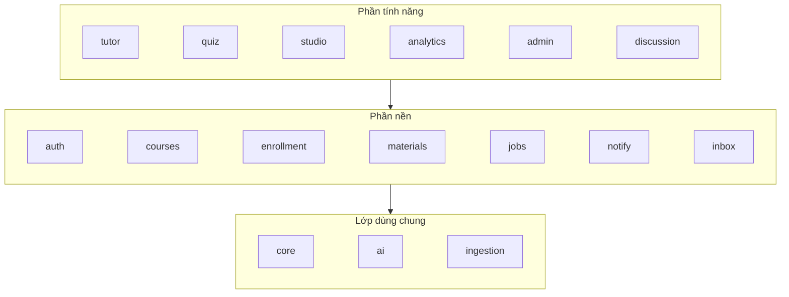

# Các phần của hệ thống và cách sửa từng phần

Hệ thống là **một khối chia module** (modular monolith): một backend, một database, nhưng mỗi tính năng nằm trong thư mục riêng, có test riêng, và ranh giới giữa các phần được CI kiểm tra tự động. Sửa một phần thì chỉ đọc, sửa và chạy test của phần đó.

## 1. Bản đồ backend (`backend/app/`)

### Phần nền

| Module | Làm gì | Bảng DB | Test chính |
|---|---|---|---|
| `auth` | Đăng ký, đăng nhập, JWT, refresh xoay vòng, xác minh email, rate limit đăng nhập / đăng ký | `users`, `refresh_tokens`, `email_tokens` | `test_auth.py`, `test_refresh.py`, `test_email.py`, `test_auth_ratelimit.py`, `test_locked.py` |
| `courses` | Khóa học, chương, bài; catalog + cache | `courses`, `sections`, `lessons` | `test_courses.py`, `test_catalog.py`, `test_course_content.py`, `test_course_cache.py` |
| `enrollment` | Đăng ký khóa, tiến độ, quyền xem bài | `enrollments`, `lesson_progress` | `test_enrollment.py`, `test_lesson_access.py`, `test_delete_guards.py` |
| `materials` | Upload (staging → kiểm tra → key chính thức), tài liệu PDF, đoạn (chunk) | `assets`, `sources`, `source_pages`, `chunks` | `test_uploads.py`, `test_sources_api.py`, `test_chunks_db.py`, `test_pipeline.py` |
| `jobs` | Tạo job nền chống trùng, đưa vào hàng đợi sau commit | `jobs` | `test_jobs.py`, `test_worker.py` |
| `notify` | Hộp thư đi email (outbox), gửi SMTP | `email_outbox` | `test_email.py`, `test_mailer.py` |
| `inbox` | Thông báo trong app (B6): ghi cùng transaction với sự kiện, báo hiệu qua Redis, luồng SSE số chưa đọc | `notifications` | `test_notifications.py` |

### Phần tính năng

| Module | Làm gì | Bảng DB | Test chính |
|---|---|---|---|
| `tutor` | AI Tutor: RAG, SSE, phản hồi 👍👎 | `chat_sessions`, `chat_messages` | `test_tutor_*.py` (`models`, `api`, `sessions`, `answer`, `text`) |
| `quiz` | Sinh câu hỏi bằng AI, duyệt, quiz, làm bài, chấm | `questions`, `quizzes`, `quiz_questions`, `quiz_attempts`, `attempt_answers` | `test_quiz_*.py`, `test_questions_api.py`, `test_quizzes_api.py`, `test_attempts_api.py`, `test_submit_api.py` |
| `studio` | AI Studio: hướng dẫn tài liệu, báo cáo, flashcard, ghi chú | `source_guides`, `study_artifacts`, `flashcard_reviews`, `notes` | `test_studio.py`, `test_notes.py` |
| `analytics` | Thống kê khóa cho giảng viên, phân tích lớp (B7: câu hay sai, bài yếu, học viên cần để ý) | (chỉ đọc) | `test_analytics.py`, `test_insights.py` |
| `discussion` | Thảo luận theo bài (B4): câu hỏi và trả lời một cấp, xóa mềm | `lesson_comments` | `test_discussion.py` |
| `admin` | Duyệt giảng viên, khóa tài khoản, ẩn khóa, nhật ký, CSV, token AI | `admin_actions` | `test_admin.py` |

### Lớp dùng chung

| Thư mục | Làm gì |
|---|---|
| `core/` | Cấu hình, DB, lỗi, middleware, phân quyền, rate limit, storage, cache, metrics, `/ready` |
| `ai/` | Provider AI (giả / Gemini / OpenRouter), `LLMClient` (thử lại, cache `llm_cache`, ghi `ai_calls`), prompt, retrieval |
| `ingestion/` | PDF → trang → đoạn → embedding |
| `worker/` | Khai báo job nền cho arq (gọi vào service của module) |
| `backend/eval/` | Benchmark AI (không chạy trong server) |

### Quy tắc phụ thuộc (CI kiểm bằng `uv run lint-imports`, cấu hình ở `backend/.importlinter`)

- Phần tính năng được dùng phần nền; **phần nền không được import phần tính năng**.
- `tutor` và `quiz` không phụ thuộc nhau.
- `notify` không phụ thuộc module nào: ai cần gửi mail thì gọi `queue_email`.
- `inbox` chỉ dựa vào `core` và `auth`: module nào cần báo cho người dùng thì gọi `inbox.service.add` trước commit, `publish` sau commit.
- `core`, `ai`, `ingestion` không import phần tính năng, `main` hay `worker`.
- Ngoại lệ duy nhất (ghi rõ trong `.importlinter`): `courses.service` **đọc** bảng của quiz và tutor để chặn xóa khóa đã có học viên làm bài / hỏi AI.

## 2. Bản đồ frontend (`frontend/src/`)

| Thư mục | Làm gì |
|---|---|
| `app/` | Các trang (route). `app/(main)/admin/**` là khu quản trị |
| `components/ui`, `components/app`, `components/content` | Dùng chung: nút, hộp thoại, tab lọc, khung trang, hiển thị markdown |
| `components/<tính năng>` | `auth`, `course`, `lesson`, `tutor`, `quiz`, `studio`, `teach`, `admin` |
| `lib/` | Gọi API, truy vấn TanStack Query, đăng nhập, tiện ích |

Quy tắc (ESLint `no-restricted-imports` trong `eslint.config.mjs`):

- `lib`, `components/ui`, `components/app`, `components/content` không import component của tính năng nào (trừ file test).
- `components/admin` chỉ dùng trong khu quản trị.

## 3. Sửa một phần thì làm gì

| Sửa | Chạy test trên máy | CI chạy | Deploy khởi động lại |
|---|---|---|---|
| Một module backend, ví dụ `studio` | `uv run pytest tests/test_studio.py tests/test_notes.py`, rồi `uv run lint-imports` | `lint`, `test`, `docker`, `audit`, và `frontend` (kiểm kiểu API) | `api`, `worker` |
| Lớp AI (`app/ai/`), ví dụ thêm OpenRouter | `uv run pytest tests/test_llm_*.py tests/test_ai_*.py tests/test_tutor_answer.py tests/test_prompts.py` | như trên | `api`, `worker` |
| Giao diện một tính năng | `npx vitest run src/components/<tính năng>`, `npx playwright test e2e/<tên>.spec.ts` (các file hiện có: `student`, `teacher`, `teacher-quiz`, `quiz`, `studio`, `admin`, `auth-email`, `review-fixes`) | `frontend`, `docker`, `audit` | `web` |
| Hạ tầng (`infra/`, `docker-compose.prod.yml`) | `bash infra/deploy/test_deploy.sh` | `infra` | cả stack |
| Chỉ tài liệu (`docs/`, `*.md`) | — | chỉ job `changes` | không gì |

Trước khi push vẫn nên chạy đủ test của phía mình sửa (`uv run pytest -q` hoặc `npm test`), vì một module có thể bị module khác dùng lại.
