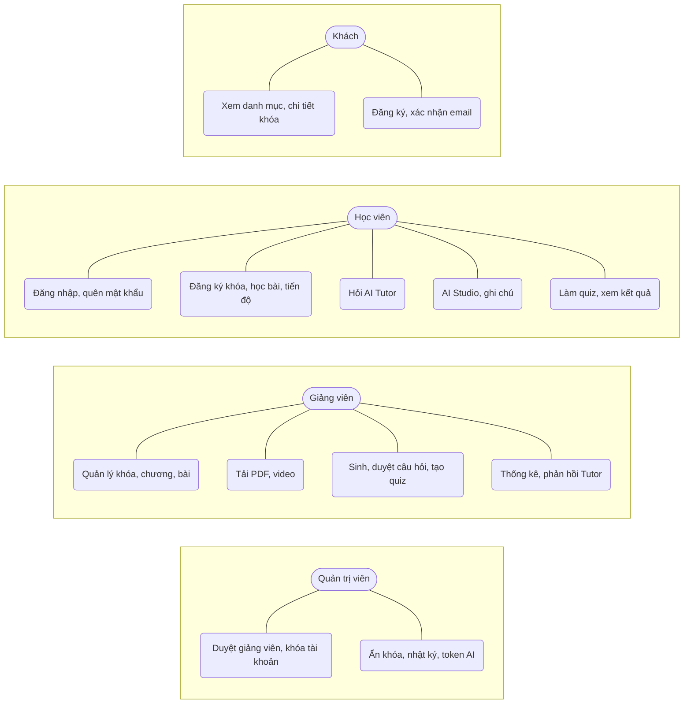
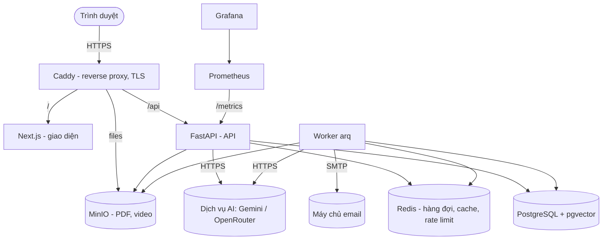
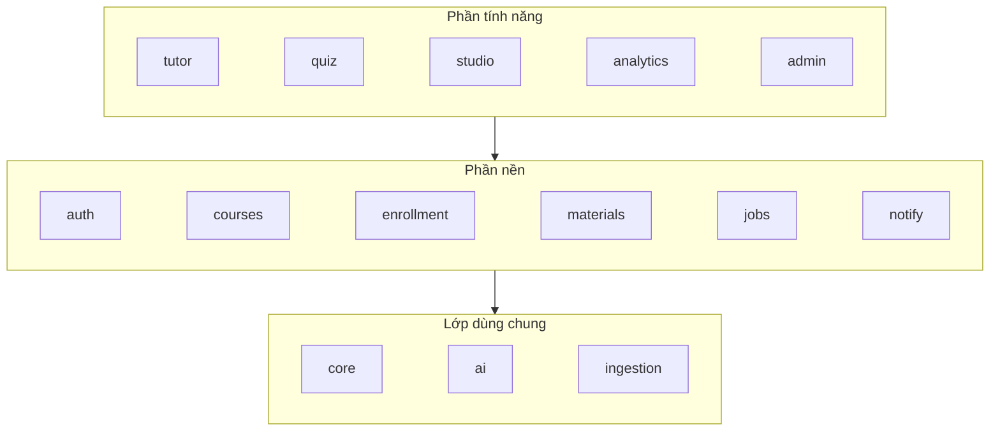
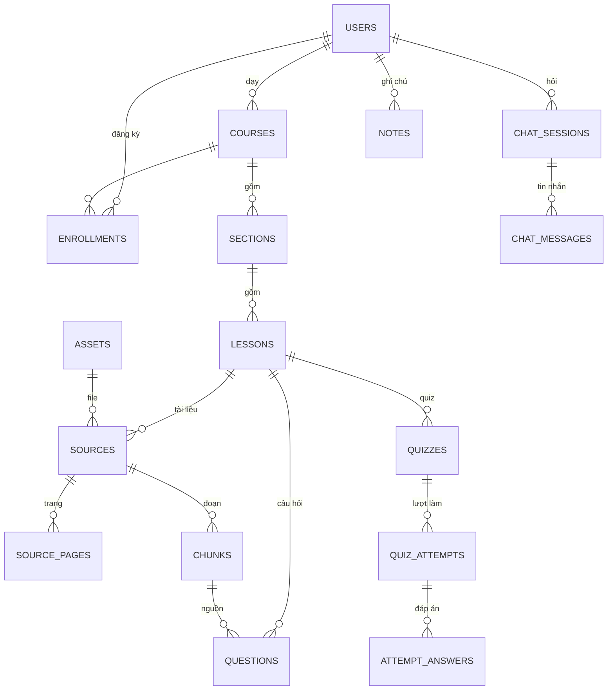
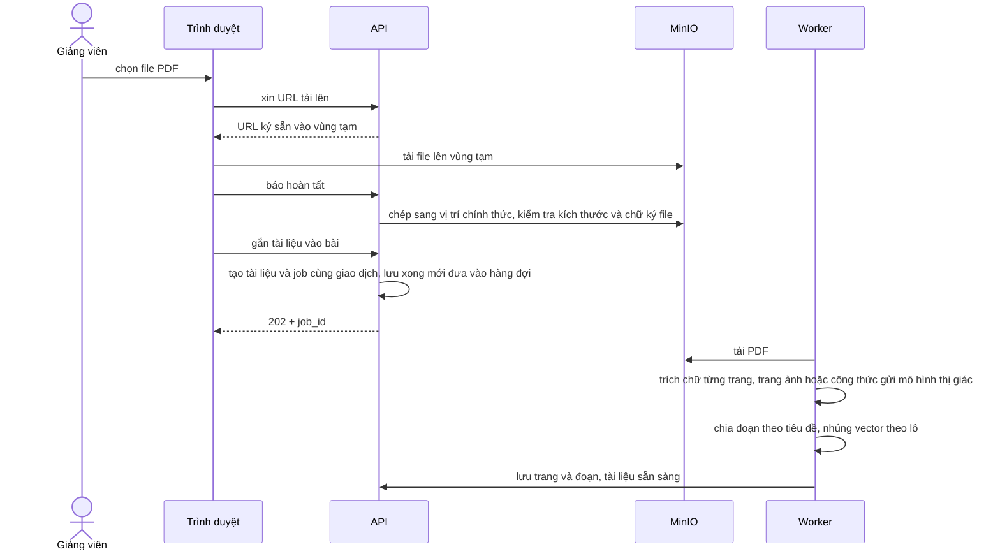
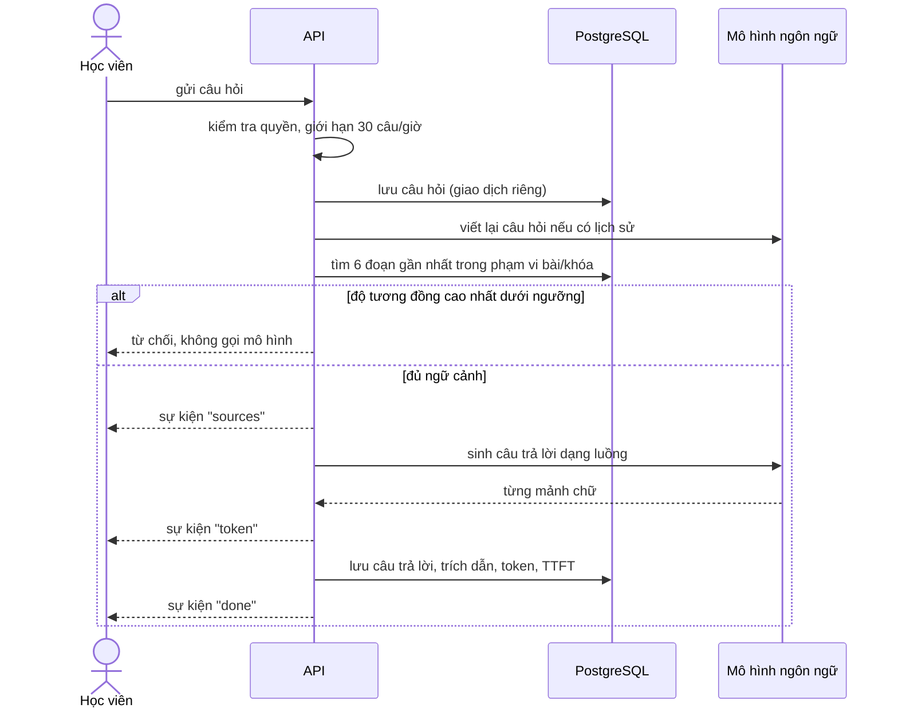

# PHÂN TÍCH VÀ THIẾT KẾ HỆ THỐNG

## Phân tích yêu cầu

### Tác nhân

| Tác nhân | Mô tả |
|---|---|
| Khách | Người chưa đăng nhập: xem danh mục khóa học, trang giới thiệu khóa, đăng ký tài khoản |
| Học viên | Đăng ký khóa, học bài, hỏi AI Tutor, dùng AI Studio, làm quiz, ghi chú |
| Giảng viên | Đăng ký rồi chờ quản trị viên duyệt. Tạo và quản lý khóa học, tải tài liệu, sinh và duyệt câu hỏi, tạo quiz, xem thống kê |
| Quản trị viên | Được tạo sẵn bằng lệnh. Duyệt giảng viên, khóa tài khoản, ẩn khóa học vi phạm, xem nhật ký và chi phí AI |
| Worker (hệ thống) | Tiến trình nền: xử lý tài liệu, sinh câu hỏi, sinh nội dung AI Studio, trả lời câu hỏi chờ, gửi email, dọn job treo |

### Yêu cầu chức năng

Bảng sau liệt kê các chức năng chính theo nhóm.

| Nhóm | Chức năng | Tác nhân |
|---|---|---|
| Tài khoản | Đăng ký (giảng viên chờ duyệt), xác nhận email, đăng nhập, đăng xuất, làm mới phiên, quên mật khẩu qua email, xem và sửa hồ sơ | Mọi người dùng |
| Khóa học | Tạo, sửa, xóa khóa/chương/bài; sắp xếp lại bằng nút hoặc kéo thả; soạn nội dung Markdown có công thức, tự lưu; xuất bản | Giảng viên |
| Tài liệu | Tải PDF/video lên (tối đa 50MB/500MB), theo dõi trạng thái xử lý, xem từng trang đã trích, xử lý lại | Giảng viên |
| Học tập | Danh mục có tìm kiếm, đăng ký khóa, trang học bài (nội dung, video nhớ vị trí, tài liệu xem/tải được ngay), đánh dấu hoàn thành, "khóa của tôi" có tiến độ | Học viên |
| AI Tutor | Hỏi theo bài hoặc cả khóa, câu trả lời hiện dần, trích nguồn bấm xem được đoạn và trang, dừng sinh, thử lại, đánh giá 👍/👎, gợi ý hỏi tiếp, lưu vào ghi chú, gửi câu hỏi chờ khi tài liệu đang xử lý | Học viên (giảng viên và quản trị viên dùng để xem thử) |
| Câu hỏi & quiz | Sinh câu hỏi bằng AI theo số câu và độ khó, duyệt/sửa/loại, tạo quiz từ câu đã duyệt, xuất bản; học viên làm bài có tự lưu, nộp, xem kết quả và giải thích | Giảng viên, học viên |
| AI Studio | Hướng dẫn tài liệu, đề cương, tóm tắt, hỏi đáp, dòng thời gian, flashcard (theo bài hoặc cả khóa); giảng viên sửa và duyệt nội dung | Học viên, giảng viên |
| Ghi chú | Tạo, sửa, xóa ghi chú; lưu câu trả lời AI vào ghi chú; chọn nhiều ghi chú để AI tổng hợp thành đề cương | Học viên |
| Thống kê | Số đăng ký, tỉ lệ hoàn thành từng bài, điểm quiz, thống kê Tutor, danh sách phản hồi 👎 | Giảng viên |
| Quản trị | Tổng quan hệ thống, duyệt/từ chối giảng viên, khóa/mở khóa tài khoản, ẩn khóa học kèm lý do, nhật ký thao tác, xuất CSV, thống kê token AI 7 ngày | Quản trị viên |

### Yêu cầu phi chức năng

| Nhóm | Yêu cầu |
|---|---|
| Bám tài liệu | AI Tutor chỉ trả lời từ tài liệu của khóa, bắt buộc trích nguồn, từ chối câu ngoài phạm vi |
| Có người duyệt | Câu hỏi AI sinh ra chỉ vào quiz sau khi giảng viên duyệt |
| Tin cậy | Lỗi AI không làm mất câu hỏi của học viên; job nền không bị chạy trùng; job treo được tự phát hiện và đánh dấu lỗi; email không mất khi máy chủ email lỗi tạm thời |
| Bảo mật | Theo OWASP Top 10; truy cập tài nguyên của người khác trả 404 để không lộ sự tồn tại |
| Hiệu năng | Câu trả lời AI hiện chữ đầu tiên trong vài giây (đo TTFT); danh mục khóa học có bộ nhớ đệm |
| Giao diện | Đáp ứng 375px / 768px / 1280px; mọi màn hình dữ liệu có đủ 4 trạng thái (đang tải, trống, lỗi có nút thử lại, có dữ liệu); ba chế độ màu; dùng được bằng bàn phím; tương phản đạt WCAG AA |
| Bảo trì | Mỗi tính năng nằm trong module riêng, ranh giới được kiểm tra tự động; đổi nhà cung cấp AI chỉ cần sửa cấu hình |
| Vận hành | Triển khai bằng Docker, có kiểm tra sức khỏe, giám sát, sao lưu hằng ngày, tự quay lui khi bản mới lỗi |

## Kiến trúc hệ thống

### Lựa chọn kiến trúc

Hệ thống theo kiến trúc **khối chia module** (modular monolith): một backend, một CSDL, nhưng mỗi tính năng nằm trong một module riêng có model, schema, service, router và test riêng. So với microservices, cách này phù hợp với một người phát triển trong 5 tuần: không phải xử lý giao dịch phân tán, triển khai đơn giản, nhưng vẫn giữ được ranh giới rõ ràng để bảo trì. Ranh giới được kiểm tra tự động bằng import-linter (backend) và ESLint (frontend) trong CI.

Các tác vụ chậm (xử lý PDF, sinh câu hỏi, sinh nội dung AI Studio, gửi email) chạy trong **worker** riêng qua hàng đợi Redis, để API luôn trả lời nhanh.

### Sơ đồ container và triển khai

- **Caddy** là cổng vào duy nhất (cổng 80/443), tự cấp chứng chỉ HTTPS; các dịch vụ còn lại chỉ nằm trong mạng nội bộ của Docker.
- **Web và API cùng tên miền:** đường dẫn `/api` đi thẳng tới FastAPI, nhờ đó cookie làm mới phiên không cần CORS.
- **Trình duyệt tải file trực tiếp lên MinIO** bằng URL ký sẵn, file lớn không đi qua API.

### Phân lớp và module backend

| Module | Trách nhiệm |
|---|---|
| `auth` | Đăng ký, đăng nhập, JWT, làm mới phiên xoay vòng, xác nhận email, đặt lại mật khẩu, giới hạn tần suất |
| `courses` | Khóa học, chương, bài; danh mục có bộ nhớ đệm |
| `enrollment` | Đăng ký khóa, tiến độ, kiểm tra quyền xem bài |
| `materials` | Tải file (qua vùng tạm, kiểm tra rồi mới chấp nhận), tài liệu, trang, đoạn |
| `jobs` | Tạo job nền chống trùng, đưa vào hàng đợi sau khi giao dịch hoàn tất |
| `notify` | Hộp thư đi email (outbox) và gửi SMTP |
| `tutor` | AI Tutor: RAG, SSE, trạng thái tài liệu, câu hỏi chờ |
| `quiz` | Sinh câu hỏi, duyệt, quiz, làm bài, chấm điểm |
| `studio` | Hướng dẫn tài liệu, báo cáo, flashcard, ghi chú |
| `analytics` | Thống kê khóa cho giảng viên |
| `admin` | Chức năng quản trị và nhật ký |
| `core` | Cấu hình, CSDL, lỗi, middleware, phân quyền, lưu trữ, bộ nhớ đệm, số liệu giám sát |
| `ai` | Nhà cung cấp AI (giả lập / Gemini / OpenRouter), lớp gọi LLM chung, prompt, truy xuất |
| `ingestion` | PDF → trang → đoạn → vector |

Quy tắc phụ thuộc: phần tính năng được dùng phần nền; phần nền **không** được dùng phần tính năng; `tutor` và `quiz` độc lập với nhau; `notify` không phụ thuộc module nào; lớp dùng chung không phụ thuộc tầng trên. Nhờ vậy có thể sửa hoặc bỏ một tính năng mà không ảnh hưởng phần nền.

## Thiết kế cơ sở dữ liệu

CSDL gồm 28 bảng trên PostgreSQL 16. Quy ước: khóa chính UUID, thời gian kiểu `timestamptz`, mọi bảng có `created_at`. Các bảng chia theo nhóm:

| Nhóm | Bảng |
|---|---|
| Tài khoản | `users`, `refresh_tokens`, `email_tokens` |
| Khóa học | `courses`, `sections`, `lessons`, `enrollments`, `lesson_progress` |
| Tài liệu | `assets`, `sources`, `source_pages`, `chunks`, `jobs` |
| AI Tutor | `chat_sessions`, `chat_messages`, `llm_cache`, `ai_calls` |
| Quiz | `questions`, `quizzes`, `quiz_questions`, `quiz_attempts`, `attempt_answers` |
| AI Studio | `source_guides`, `study_artifacts`, `flashcard_reviews`, `notes` |
| Vận hành | `email_outbox`, `admin_actions` |

Sơ đồ quan hệ của các bảng chính:

Một số điểm thiết kế đáng chú ý:

- **`chunks`** lưu nội dung đoạn, `heading_path`, `page_no`, số token, tên mô hình nhúng (`embedding_model`) và vector 768 chiều. Chỉ mục HNSW cho tìm vector, chỉ mục GIN cho cột toàn văn `tsv` (cột sinh tự động từ nội dung đã bỏ dấu), chỉ mục B-tree `(course_id, lesson_id, embedding_model)` cho phép lọc phạm vi. Lưu tên mô hình nhúng giúp hệ thống không trộn vector của hai mô hình khác nhau khi đổi nhà cung cấp.
- **`jobs`** có chỉ mục duy nhất một phần `uq_active_job (type, ref_id, ref_version) WHERE status IN ('pending','processing')`: hai yêu cầu đồng thời cũng chỉ tạo được một job đang chạy cho cùng một đối tượng, không cần khóa phân tán.
- **`chat_messages`** lưu trích dẫn dạng JSONB, cờ `refused`/`truncated`, phản hồi 👍/👎, số token, độ trễ, TTFT, phiên bản prompt (phục vụ đánh giá), và cờ `waiting_for_docs` cho câu hỏi gửi lúc tài liệu đang xử lý.
- **`questions`** lưu `ai_original` (bản gốc AI sinh), `review_status`, `self_check_flag`, `source_chunk_id`, để thống kê tỉ lệ giữ/sửa/loại.
- **`quiz_attempts`** có ràng buộc duy nhất `(quiz_id, user_id, attempt_no)` và trạng thái `in_progress/completed/timed_out`; việc chốt bài dùng câu lệnh cập nhật có điều kiện để không bao giờ bị chấm hai lần.
- **`email_tokens`** và **`refresh_tokens`** chỉ lưu giá trị băm SHA-256, không lưu mã gốc.

Sơ đồ ERD đầy đủ (28 bảng, mọi cột) được sinh tự động từ model và kiểm tra trong CI để luôn khớp với mã (`docs/architecture/erd.md`).

## Thiết kế API

- REST + JSON, tiền tố `/api/v1`, khoảng 90 endpoint; tài liệu OpenAPI sinh tự động.
- **Lỗi thống nhất:** `{"error": {"code", "message", "details", "request_id"}}` với mã lỗi cố định (ví dụ `RATE_LIMITED`, `QUIZ_ATTEMPT_LIMIT`, `AI_UNAVAILABLE`); lỗi không lường trước trả `500 INTERNAL_ERROR` không lộ chi tiết, chi tiết ghi vào log kèm `request_id`.
- **Phân trang** `?page=&size=`, trả `{items, total, page, size}`, thứ tự luôn ổn định.
- **Tác vụ chậm** trả `202 {job_id}`; giao diện theo dõi qua `GET /jobs/{id}`.
- **Phân quyền** bằng dependency của FastAPI (`require_role`, `require_teacher_approved`, kiểm tra chủ sở hữu, kiểm tra đăng ký khóa). Truy cập tài nguyên của người khác trả `404` thay vì `403`.
- **Xác thực:** access token JWT sống 15 phút giữ trong bộ nhớ trình duyệt; refresh token 7 ngày trong cookie `HttpOnly; SameSite=Lax`, xoay vòng mỗi lần dùng; nếu một refresh token đã bị thu hồi mà bị dùng lại (dấu hiệu bị đánh cắp) thì toàn bộ phiên của người dùng đó bị thu hồi.

## Thiết kế các luồng AI

### Lớp gọi AI dùng chung

Mọi lời gọi mô hình đi qua một lớp chung (`LLMClient`) đảm nhận: thời gian chờ theo từng loại lời gọi; thử lại tối đa 3 lần với lỗi 429/5xx/hết giờ (chờ tăng dần, tôn trọng header `Retry-After`); bộ nhớ đệm theo băm (nhà cung cấp, mô hình, prompt, lược đồ JSON), chỉ lưu kết quả hoàn chỉnh; ghi mỗi lời gọi vào bảng `ai_calls` (loại tác vụ, mô hình, token, thời gian) để quản trị viên theo dõi chi phí. Nhà cung cấp là một giao diện (`LLMProvider`, `Embedder`, `VisionExtractor`) với ba cài đặt: giả lập (dùng khi phát triển và kiểm thử, không tốn tiền), Gemini, OpenRouter; chọn qua biến môi trường. Prompt nằm trong file Markdown riêng có đánh số phiên bản; mỗi kết quả lưu kèm phiên bản prompt.

### Xử lý tài liệu PDF

Trang có ít hơn 50 ký tự chữ (trang ảnh) hoặc có công thức được chuyển thành ảnh và gửi mô hình thị giác để lấy Markdown (công thức dạng LaTeX). Số trang gửi mô hình thị giác có trần (cấu hình) để kiểm soát chi phí; vượt trần thì dùng chữ thường và ghi cảnh báo. Các trang được gửi song song (tối đa 4 lời gọi cùng lúc). Đoạn được chia theo tiêu đề Markdown, tối đa khoảng 700 token, chồng lấn 100 token, giữ số trang và đường dẫn tiêu đề.

### AI Tutor

Thiết kế bảo đảm: câu hỏi luôn được lưu trước khi gọi mô hình (mô hình lỗi vẫn không mất câu hỏi); câu trả lời luôn được lưu, kể cả khi người dùng bấm dừng hoặc mất kết nối (đánh dấu `truncated`); quyền được kiểm tra lại ở mỗi câu hỏi (học viên bị hủy đăng ký giữa chừng thì bị từ chối); máy chủ kiểm tra người dùng còn kết nối không sau mỗi 10 mảnh chữ để dừng gọi mô hình khi không còn ai nghe.

### Câu hỏi chờ khi tài liệu đang xử lý

Xử lý một bộ slide lớn có thể mất hơn một phút. Thay vì khóa ô hỏi, hệ thống cho học viên gửi câu hỏi; câu hỏi được lưu với cờ `waiting_for_docs`. Khi job xử lý tài liệu kết thúc, worker xếp một job trả lời các câu hỏi chờ của bài đó, dùng đúng luồng AI Tutor ở trên; một tác vụ định kỳ 5 phút vét các câu bị lỡ. Mỗi câu được "nhận" bằng một câu lệnh cập nhật có điều kiện nên không bao giờ được trả lời hai lần. Giao diện tự hỏi lại máy chủ mỗi 5 giây và hiển thị câu trả lời ngay dưới câu hỏi. Đồng thời, hệ thống báo đúng lý do chưa hỏi được: tài liệu đang xử lý, xử lý lỗi, được xử lý bằng mô hình nhúng khác, hay bài chưa có tài liệu.

### Sinh câu hỏi trắc nghiệm

1. Chọn các đoạn dài từ 150 token, ưu tiên đoạn chưa được dùng để sinh câu hỏi, rải đều theo tiêu đề để phủ cả bài.
2. Mỗi đoạn sinh 2–3 câu bằng đầu ra có cấu trúc; kiểm tra: đúng 4 lựa chọn, đúng 1 đáp án, không trùng lựa chọn. Sai thì thử lại một lần, vẫn sai thì bỏ.
3. Lọc trùng: nhúng phần đề, độ tương đồng trên 0.9 so với câu đã có của bài thì bỏ.
4. Tự kiểm tra: một lời gọi khác làm lại câu hỏi chỉ dựa trên đoạn nguồn; kết quả khác đáp án thì gắn cờ để giảng viên chú ý.
5. Lưu ở trạng thái chờ duyệt, kèm bản gốc của AI và đoạn nguồn.

### AI Studio

Nội dung (đề cương, tóm tắt, hỏi đáp, dòng thời gian, flashcard) được sinh **một lần cho mỗi bài hoặc khóa** và dùng chung cho cả lớp, có "dấu vân tay" (fingerprint) của tập tài liệu: tài liệu đổi thì nội dung được đánh dấu cũ và có thể sinh lại; bản đã được giảng viên sửa thì không bao giờ bị ghi đè tự động. Tài liệu dài được xử lý theo kiểu map-reduce: tóm tắt từng lô (giữ nhãn nguồn), rồi viết báo cáo từ các bản tóm tắt. Khóa tư vấn (advisory lock) của PostgreSQL bảo đảm hai học viên bấm cùng lúc chỉ sinh một lần.

## Thiết kế bảo mật

| Rủi ro (OWASP 2021) | Biện pháp chính |
|---|---|
| Kiểm soát truy cập | Dependency phân quyền ở mọi endpoint; tài nguyên của người khác trả 404; kiểm tra quyền lại ở mỗi câu hỏi Tutor |
| Mật mã | Mật khẩu băm argon2; token chỉ lưu SHA-256; HTTPS + HSTS; cookie `HttpOnly`, `Secure` khi chạy thật |
| Chèn mã (injection) | Truy vấn tham số hóa; thoát ký tự `LIKE`; chặn công thức khi xuất CSV; tài liệu và câu hỏi được bọc thẻ trong prompt và coi là dữ liệu |
| Thiết kế không an toàn | Tải file qua vùng tạm rồi máy chủ mới kiểm tra; chống tạo job trùng bằng chỉ mục; chốt bài quiz nguyên tử; email qua outbox cùng giao dịch |
| Cấu hình sai | Chỉ Caddy mở cổng ra ngoài; Redis có mật khẩu; CORS đúng nguồn; header bảo mật cho API và web |
| Thành phần có lỗ hổng | Khóa phiên bản phụ thuộc; CI chạy `pip-audit` và `npm audit` |
| Xác thực | Token ngắn hạn, làm mới xoay vòng, phát hiện dùng lại; bắt xác nhận email; giới hạn tần suất đăng nhập, đăng ký, gửi lại email, quên mật khẩu |
| Toàn vẹn dữ liệu | Kiểm tra chữ ký file (magic bytes) khi tải lên; CD chỉ triển khai bản đã qua CI |
| Ghi log, giám sát | `request_id` cho mọi yêu cầu; nhật ký thao tác quản trị; nhật ký lời gọi AI; Grafana theo dõi lỗi 5xx, job lỗi |
| SSRF | Máy chủ không tải URL do người dùng nhập |

## Thiết kế giao diện

### Nguyên tắc

Giao diện thiết kế cho việc **học lâu không mỏi mắt**: không dùng trắng/đen tuyệt đối; tương phản chữ nội dung 10.9–14.4:1 (vượt chuẩn AAA nhưng không gắt); màu nhấn dùng tiết kiệm; chữ đọc 17px (chỉnh được 15–21px), giãn dòng 1.75, dòng tối đa khoảng 68 ký tự; gần như không có chuyển động; ba chế độ màu Sáng, Tối dịu và Giấy (sepia). Font Be Vietnam Pro cho giao diện, Noto Sans cho nội dung, JetBrains Mono cho mã, đều hỗ trợ đầy đủ dấu tiếng Việt. Thông tin không bao giờ chỉ truyền bằng màu: đúng/sai luôn kèm biểu tượng và chữ.

### Các màn hình chính

| Màn hình | Nội dung |
|---|---|
| Khám phá, chi tiết khóa | Danh mục có tìm kiếm, giới thiệu khóa, mục lục, nút đăng ký |
| Trang học bài | Mục lục bên trái, nội dung ở giữa (video, Markdown có công thức, tài liệu PDF xem/tải được), cột "Trợ lý học tập" bên phải với 4 tab: AI Tutor, Studio, Tài liệu, Ghi chú. Trên điện thoại, trợ lý mở dạng khung trượt từ dưới lên |
| Làm quiz, kết quả | Từng câu, tự lưu, nộp có xác nhận, kết quả kèm đáp án và giải thích |
| Khu giảng viên | Danh sách khóa, trình soạn khóa (kéo thả sắp xếp), trình soạn bài (tự lưu, xem trước, tải tài liệu), duyệt câu hỏi, quiz, thống kê |
| Khu quản trị | Tổng quan, người dùng, khóa học, phản hồi Tutor, nhật ký |
| Tài khoản | Đăng nhập, đăng ký, xác nhận email, quên/đặt lại mật khẩu, hồ sơ |

[CẦN CHÈN: ảnh chụp các màn hình chính ở cả giao diện máy tính và điện thoại.]

## Kết luận chương

Chương này đã phân tích tác nhân, yêu cầu chức năng và phi chức năng, và trình bày thiết kế kiến trúc khối chia module, CSDL 28 bảng, API, các luồng AI, bảo mật và giao diện. Các quyết định thiết kế ưu tiên tính đúng đắn khi có lỗi và khi có thao tác đồng thời (lưu trước khi gọi AI, chống job trùng bằng chỉ mục, cập nhật có điều kiện), vì đây là những chỗ hệ thống có AI dễ hỏng nhất. Chương tiếp theo trình bày việc hiện thực thiết kế này.
